# Laboratory Activity 10: Mission 10 – The Enterprise Cloud Architect

**Student:** Russel Fernandez
**Course:** CCM101 – Cloud Computing, University of Eastern Pangasinan – College of Information Technology
**Stack:** WordPress + MariaDB on an Ubuntu Server VM (VirtualBox), deployed with Docker Compose

## Overview
For the final mission I designed, deployed, secured, automated, and documented a small private cloud environment for CloudNova Technologies. A WordPress site and its MariaDB database run as two linked containers on an Ubuntu Server virtual machine. The database sits on a persistent volume, the server is locked down with a UFW firewall, and a Bash script backs everything up every night through cron.

## Architecture
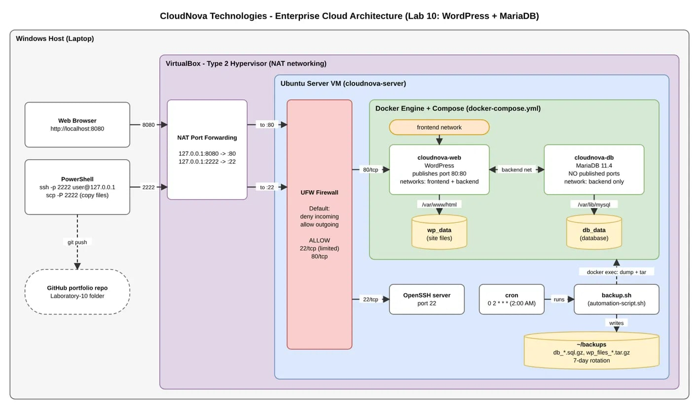

| Layer | What I used |
|---|---|
| Host | Windows laptop (browser + PowerShell) |
| Hypervisor | VirtualBox, NAT with port forwarding (`8080 → 80`, `2222 → 22`) |
| Guest OS | Ubuntu Server 26.04.1 LTS (headless) |
| Firewall | UFW, default deny incoming, allow `22/tcp` (rate limited) and `80/tcp` |
| App tier | `cloudnova-web` (WordPress), networks `frontend` + `backend` |
| Data tier | `cloudnova-db` (MariaDB 11.4), network `backend` only, no published ports |
| Persistence | Named volumes `wp_data` and `db_data` |
| Automation | `automation-script.sh` (installed on the VM as `backup.sh`), cron at 2:00 AM |

## Requirements Checklist
| # | Requirement | Evidence |
|---|---|---|
| 1 | VM, Ubuntu Server, architecture diagram, reachable from the host browser | `architecture-diagram.png`, screenshots 01, 02, 05 |
| 2 | Docker + Compose, two linked containers, persistent volumes surviving a reboot | `docker-compose.yml`, screenshots 03, 04, 08 |
| 3 | UFW enabled, default deny, only necessary ports | screenshots 06, 07 |
| 4 | Executable Bash script scheduled with cron | `automation-script.sh`, screenshots 09, 10, 11 |
| 5 | Operational manual, raw code, final reflection | `operational-manual.md`, `final-reflection.md` |

## Files in This Folder
| File | Purpose |
|---|---|
| `docker-compose.yml` | The whole stack as code |
| `.env.example` | Template for the secrets file (the real `.env` is never committed) |
| `automation-script.sh` | Nightly backup: database dump + site files, 7-day rotation |
| `operational-manual.md` | Handover manual: deploy, secure, back up, maintain, troubleshoot |
| `final-reflection.md` | Reflection on Missions 1–10 |
| `screenshots/` | Evidence for each requirement |

## Quick Start
```bash
cp .env.example .env     # then set strong passwords
docker compose up -d
```
Then open `http://<server-address>` and finish the WordPress installer. The full procedure is in [operational-manual.md](operational-manual.md).

## Screenshots
| Step | Screenshot |
|---|---|
| VirtualBox port forwarding | 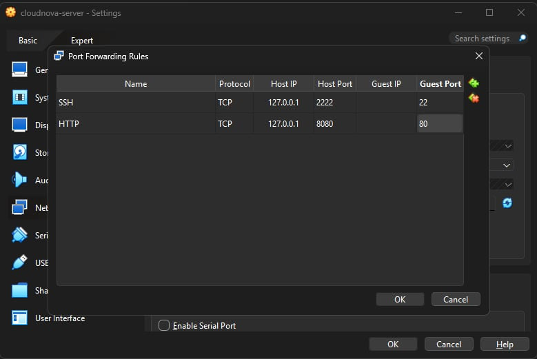 |
| SSH into the VM from PowerShell | 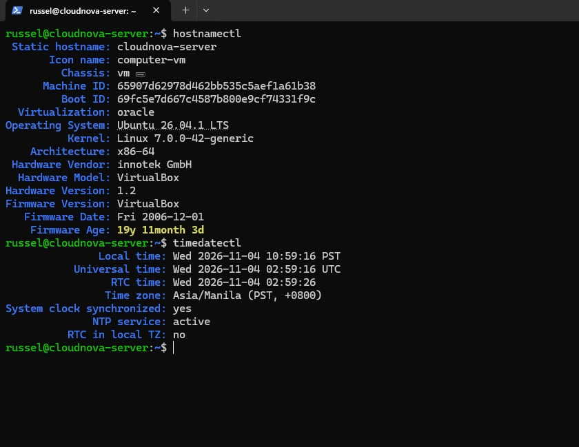 |
| Docker and Compose installed | 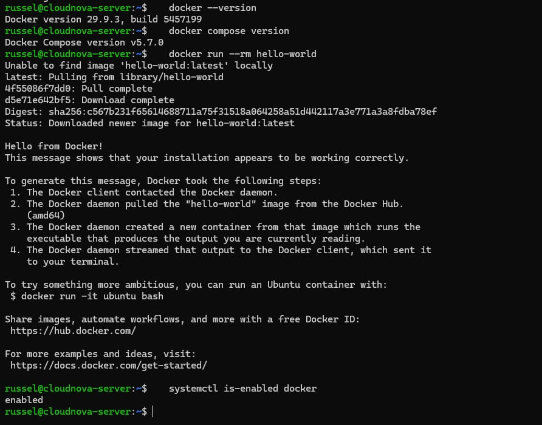 |
| Containers and volumes | 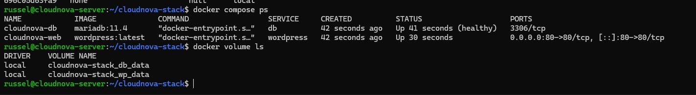 |
| WordPress in the browser | 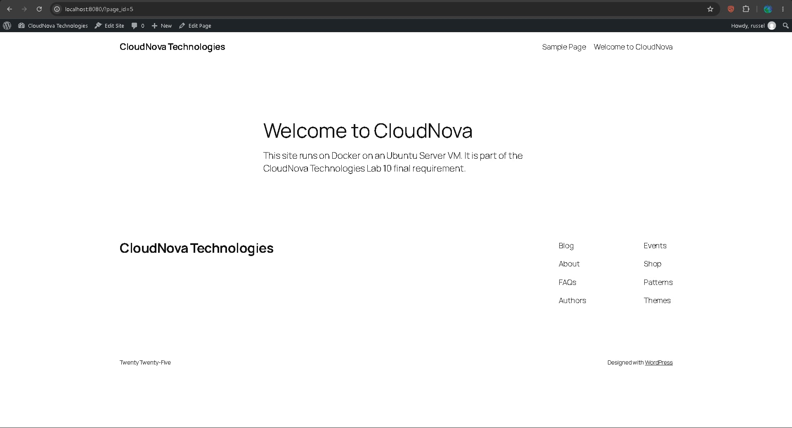 |
| UFW status (default deny) | 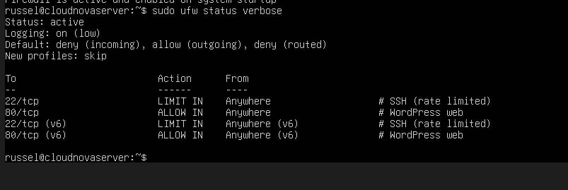 |
| Listening ports | 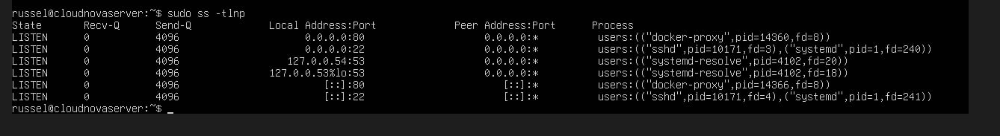 |
| After a reboot | 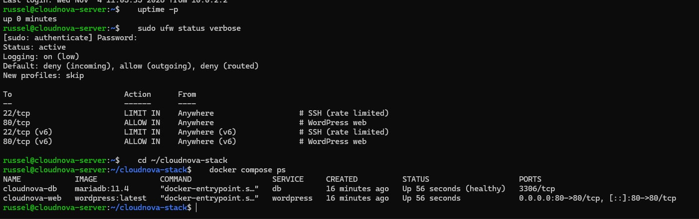 |
| Backup script run | 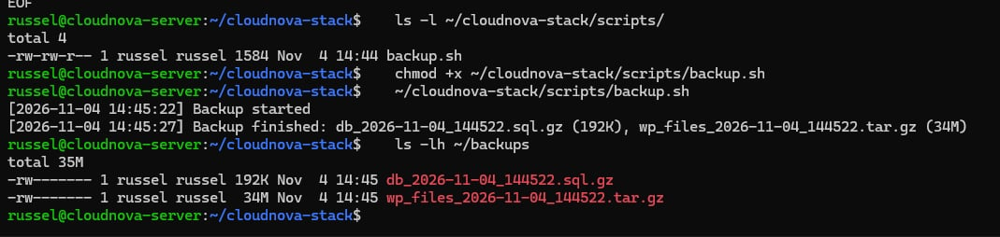 |
| Cron job and journal log | 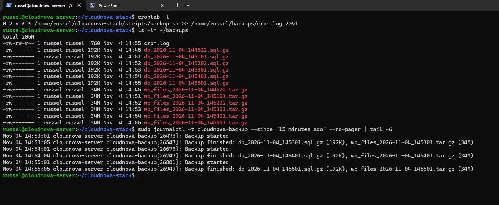 |
| Restore drill (terminal) | 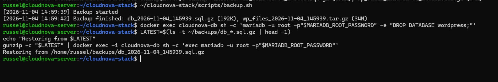 |
| Restore drill (site down) | 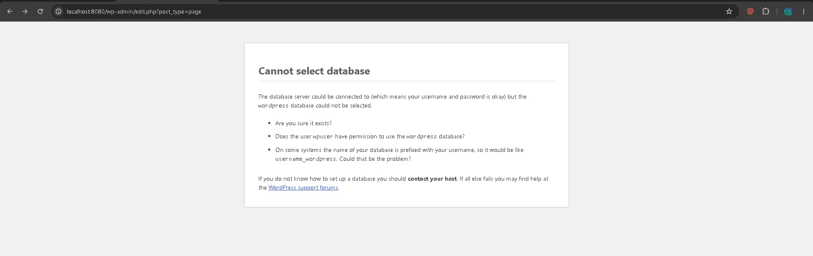 |
| Restore drill (site recovered) | 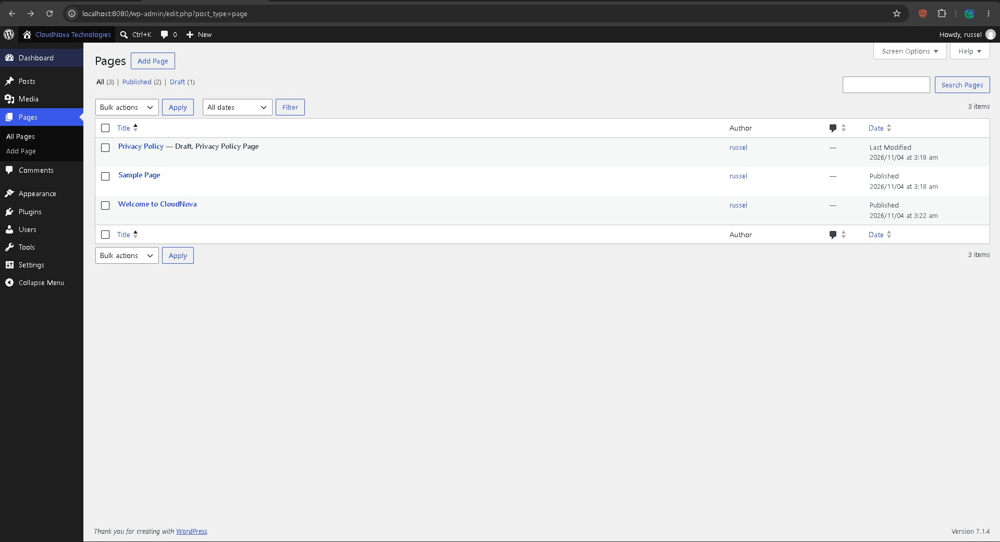 |

## References
University of Eastern Pangasinan – College of Information Technology. (2026). *CCM101 – Cloud Computing, Laboratory Activity 10: Mission 10 – The Enterprise Cloud Architect.*
